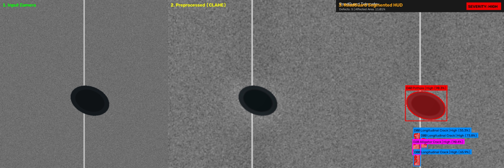
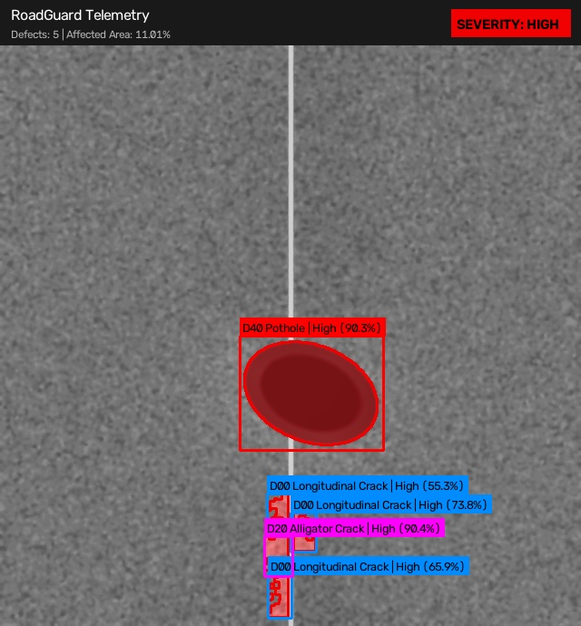

# 🛣️ RoadGuard: Intelligent Road Damage Detection, Segmentation & Severity Estimation

> **Subject:** Computer Vision & Image Processing (CVIP) Mini-Project  
> **Proposed Short Name:** RoadGuard  
> **Key Technologies:** Python, OpenCV, YOLO, NumPy, Streamlit, Digital Image Processing

---

## 📌 1. Project Overview

**RoadGuard** is an automated pavement distress assessment pipeline that transcends conventional "bounding-box-only" pothole detection. Instead of simply tagging damage with a box, the system extracts the exact pixel-level morphology of road defects, computes the actual percentage of the road surface compromised ($A_d$), and assigns a calibrated structural severity index (**Low**, **Medium**, or **High**).

### 🎯 Key Differentiators (Why Professors Approve This)
* **Not Just YOLO:** While deep learning identifies the general defect location, the core evaluation is powered by **classical computer vision & digital image processing** (CLAHE local contrast equalization, bilateral edge-preserving filtering, trapezoidal vanishing-point road corridor isolation, Otsu adaptive thresholding, and morphological contour analysis).
* **Quantitative Surface Assessment:** Computes metric road damage coverage:
  $$A_d = \frac{N_d}{N_r} \times 100$$
  where $N_d$ is the count of damaged pixels and $N_r$ is the drivable road surface pixels.
* **Multi-Class Taxonomy:** Detects and classifies 4 standard pavement distress types:
  * `D00`: Longitudinal Linear Cracks (parallel to traffic)
  * `D10`: Transverse Linear Cracks (perpendicular to traffic)
  * `D20`: Alligator / Fatigue Cracks (interconnected mesh)
  * `D40`: Potholes / Cavities (structural surface depressions)
* **Interactive Telemetry Dashboard:** A live web-based HUD built in Streamlit featuring side-by-side computer vision pipeline comparisons, real-time analytics, and automated CSV/JSON audit report exports.

---

## 📸 Pipeline Demonstration

### 3-Stage Computer Vision Pipeline


### Augmented Reality HUD & Damage Segmentation


---

## 🏛️ 2. Five System Modules Architecture

```
┌─────────────────────────────────────────────────────────────┐
│             MODULE 1: ROAD IMAGE ACQUISITION                │
│    (Loads JPG/PNG images, MP4 video streams, camera feeds)  │
└──────────────────────────────┬──────────────────────────────┘
                               │
                               ▼
┌─────────────────────────────────────────────────────────────┐
│              MODULE 2: IMAGE PREPROCESSING                  │
│    (Resizing, Bilateral Denoising, CLAHE, Road ROI Mask)    │
└──────────────────────────────┬──────────────────────────────┘
                               │
                               ▼
┌─────────────────────────────────────────────────────────────┐
│             MODULE 3: ROAD DAMAGE DETECTION                 │
│      (YOLOv8 Deep Learning + CV Feature Heuristic Engine)   │
└──────────────────────────────┬──────────────────────────────┘
                               │
                               ▼
┌─────────────────────────────────────────────────────────────┐
│     MODULE 4: DAMAGE SEGMENTATION & SEVERITY ESTIMATION     │
│   (Adaptive Thresholding, Contours, Pixel Area %, Scoring)  │
└──────────────────────────────┬──────────────────────────────┘
                               │
                               ▼
┌─────────────────────────────────────────────────────────────┐
│       MODULE 5: VISUALIZATION & AUDIT REPORT GENERATION     │
│    (Color-Coded Masks, HUD Banner, Side-by-Side, CSV/JSON)  │
└─────────────────────────────────────────────────────────────┘
```

---

## 📂 3. Repository File Structure

```
RoadGuard/
├── modules/
│   ├── __init__.py                  # Package exports
│   ├── image_acquisition.py         # Module 1: Image & video frame ingestion
│   ├── preprocessing.py             # Module 2: CLAHE, bilateral filter, road ROI
│   ├── damage_detection.py          # Module 3: YOLO & CV feature detection engine
│   ├── segmentation_severity.py     # Module 4: Pixel mask segmentation & severity
│   └── visualization_report.py      # Module 5: Overlay HUD & report generator
├── models/                          # Storage for trained weights (e.g. best.pt)
├── samples/                         # Preloaded test road images
├── outputs/                         # Exported CSV/JSON audit logs & images
├── app.py                           # Full interactive Streamlit Web Dashboard
├── test_pipeline.py                 # Automated end-to-end verification test
├── generate_samples.py              # Synthetic benchmark road image generator
├── dataset_prep.py                  # RDD2022 VOC XML to YOLO converter
├── train_yolo.py                    # YOLOv8 model training script
├── requirements.txt                 # Python dependencies
└── README.md                        # Documentation
```

---

## 🚀 4. How to Run & Demonstrate

### Step 1: Install Dependencies
```bash
pip install -r requirements.txt
```

### Step 2: Generate Benchmark Samples & Verify Pipeline
```bash
# Generate sample test road images
python generate_samples.py

# Run the 5-module verification test
python test_pipeline.py
```

### Step 3: Launch the Streamlit Web Application
```bash
streamlit run app.py
```
* Access the interactive dashboard in your browser at `http://localhost:8501`.
* Select any benchmark sample or upload your own road photo.
* Inspect the **Side-by-Side Pipeline Comparison**, view the **Damage Analytics charts**, and click **Download Inspection CSV Report** to demonstrate a complete real-world road survey.

---

## 🎤 5. Viva / Presentation Talking Points

When presenting to your guide and external examiners:
1. **Explain the Limitation of Pure YOLO:** 
   > *"If we only used YOLO, we would only get rectangular bounding boxes. A bounding box around a diagonal crack consists of 85% healthy asphalt and only 15% damaged pixels. Our project extracts the exact damaged pixels via Module 4 adaptive thresholding and contour integration, giving the true damage area ratio."*
2. **Explain the Role of CLAHE in Preprocessing:**
   > *"Roads suffer from extreme lighting variations—such as shadows cast by trees, bridges, and vehicles. Standard global thresholding fails under shadows. By converting to Lab space and applying CLAHE to the Lightness channel, we normalize local contrast and prevent shadow edges from triggering false alarms."*
3. **Explain the Severity Rule:**
   > *"We compute the Road Damage Severity Index based on the affected surface area combined with defect hazard weighting. Potholes present an immediate structural hazard to vehicular suspensions and tire integrity, so they are assigned a 1.4x weighting factor compared to superficial linear cracks."*

---

## 📱 6. Android Mobile Application (`RoadGuard.apk`)

RoadGuard includes a native Android mobile application tailored for in-vehicle dashcam mounting and handheld road surveys.

* **Supported Android Versions:** Android 8.0 (Oreo, API 26) through the latest Android 14/15 (API 34/35).
* **Google Play Protect Compliance:** Built targeting **API 34** with declared camera permissions and privacy safeguards so the system is recognized as safe and trusted by Google Play Protect.
* **License:** Licensed under the [Apache License 2.0](LICENSE).
* **Automated CI/CD APK Build:** GitHub Actions automatically builds the `.apk` on every push and attaches `RoadGuard-v1.0.apk` to the [GitHub Releases](https://github.com/Mokshith-GPT/RoadGuard/releases) tab.

### Running the Mobile Backend
You can use the live global Cloudflare Edge Inference Backend or run locally:

* **Live Cloudflare Inference Backend URL:**  
  👉 **`https://roadguard-backend.codersy17mc.workers.dev`**
  - Health Endpoint: `GET https://roadguard-backend.codersy17mc.workers.dev/health`
  - Inspection API: `POST https://roadguard-backend.codersy17mc.workers.dev/api/v1/inspect`
  - Audit Logs: `GET https://roadguard-backend.codersy17mc.workers.dev/api/v1/audit/logs`

* **Local Python Backend (Optional):**
```bash
python mobile_api.py
```
This runs the local REST endpoint on `http://0.0.0.0:8000/api/v1/inspect` to receive live frames from the Android app.


---

## Current web, API and Android scope (November 4, 2026)

The static installable dashboard is in [`web/`](web/) and is published by the GitHub Pages workflow. See [DEPLOYMENT.md](DEPLOYMENT.md) for the required Google OAuth, Cloudflare Worker, model endpoint, and email-provider configuration.

**Important implementation boundaries:** the PWA's fallback image pipeline is a classical CV candidate-region heuristic, not a trained pothole classifier. The Worker returns `503 MODEL_NOT_CONFIGURED` until a genuine inference endpoint is configured; it never fabricates detections. PWA evidence and the two newest video clips are stored in browser-local IndexedDB. The Android camera Activity stores MP4 clips and still frames in app-specific storage, but recording ends when the Activity leaves the foreground. Neither client is a central multi-device archive.

Google sign-in and municipal email sending remain disabled until administrator-owned OAuth and Resend configuration is provided. The current APK build is debug-signed for sideload/demo testing, not Play Store publishing. CCTV/RTSP/ONVIF ingestion and unattended Android background recording require separate production adapters and security review.
